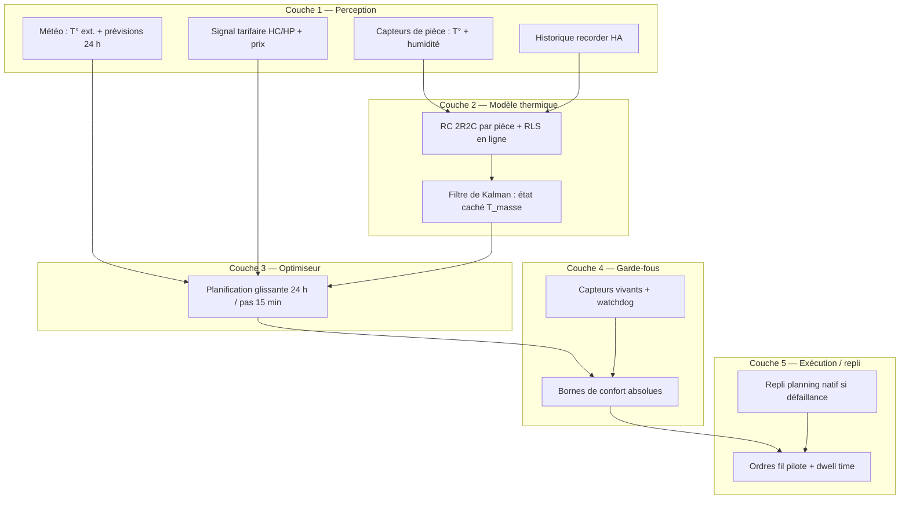
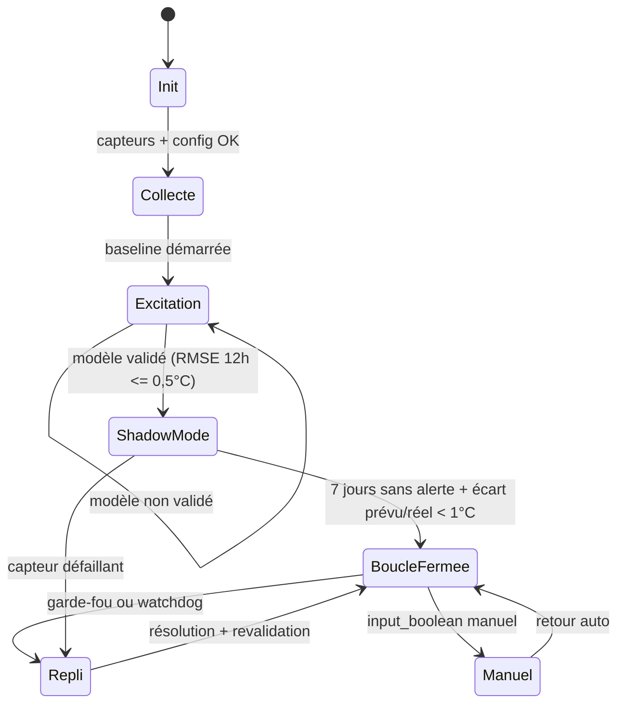
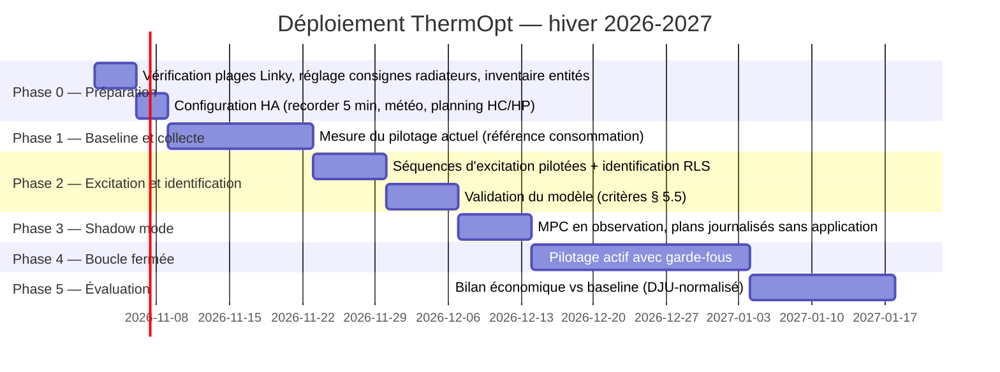

# ThermOpt — Pilotage optimal du chauffage fil pilote

**Document de cadrage clé en main** — contexte, solutions retenues, plan de déploiement et critères de validation. La structure du code (arborescence, fichiers, APIs internes) est volontairement hors périmètre.

---

## 0. Amendements validés

Ce document est conservé comme référence fonctionnelle. Il a été amendé sur les points suivants, tranchés lors de l'initialisation du projet (voir `docs/plan-initialisation.md`) :

1. **Matériel (§ 2.1)** : les modules fil pilote sont des **NodOn SIN-4-FP-21** pilotés par **Zigbee2MQTT**, et non des « Shelly + diodes ». Ils exposent `select.*_pilot_wire_mode` (6 valeurs), `switch.*` (relais), `power` (W) et `energy` (kWh).
2. **Consigne Confort paramétrable (§ 2.2, § 2.3)** : la consigne interne n'est plus fixée à 20 °C. C'est un paramètre `C` dont toute l'échelle se déduit. **Valeur retenue : `C = 20,5 °C`**, qui fait tomber Eco sur 17,0 °C et Confort−1 sur 19,5 °C — exactement les cibles du § 9.1. Avec `C = 20 °C`, Eco = 16,5 °C et le garde-fou du § 7.1.1 se déclencherait à chaque cycle nocturne.
3. **`P_rad` mesurée (§ 5.2, § 5.3)** : le capteur `power` du module donne directement la puissance restituée par ordre. L'identification RLS ne porte plus que sur la partie thermique (`C_a`, `C_m`, `H_e`, `H_am`, `H_em`), ce qui supprime le paramètre le plus mal conditionné et réduit le risque « modèle non identifiable » (§ 10).
4. **Vérification d'effet (§ 7.2)** : Zigbee2MQTT ne renvoie pas l'état réellement décodé par le radiateur — le `select` reflète la dernière valeur écrite. La « lecture retour » est donc remplacée par une vérification d'effet (`power > 0` lorsque l'ordre devrait chauffer) et par un contrôle du relais.
5. **Prérequis relais (§ 7.1)** : un `switch` à `OFF` coupe le chauffage quel que soit l'ordre. C'est un nouveau garde-fou : surveillance, alerte, remise à `ON`, et `power_on_behavior = previous` sur le module.
6. **Mesure embarquée (§ 8.2)** : la consommation est mesurée par radiateur (`energy`), plus estimée par le modèle. Le DJU ne sert qu'à normaliser la météo.
7. **`off` interdit** : ce n'est pas un ordre fil pilote mais une coupure. L'espace d'actions du MPC reste les 5 ordres du § 2.3.
8. **Profil § 9.1 aligné** sur l'échelle quantifiée : 17,0 °C (Eco) / 19,5 °C (Confort−1) / 20,5 °C (Confort, borne haute).

---

## 1. Résumé exécutif

Le projet consiste à piloter automatiquement **2 radiateurs Atlantic SOKIO** (commande **fil pilote**, 5 ordres discrets) depuis Home Assistant, afin de **minimiser la facture d'électricité d'un abonnement Heures Creuses / Heures Pleines** tout en **garantissant un confort thermique défini par l'utilisateur**, en tenant compte de la température extérieure et de l'inertie thermique de chaque pièce.

Trois piliers :

1. **Modèle thermique par pièce** : grey-box **RC 2R2C** (résistance‑capacité), identifié en ligne par moindres carrés récursifs (RLS), enrichi d'un **filtre de Kalman** pour estimer la température de la masse thermique (état non mesuré).
2. **Optimiseur MPC** (commande prédictive) : planification glissante sur 24 h par pas de 15 min, minimisant le coût € des séquences d'ordres fil pilote sous contraintes de confort, en utilisant les prévisions météo.
3. **Couche de sécurité** : garde‑fous absolus (températures plancher, détection de capteur défaillant, temps de séjour minimum) et **repli automatique** sur une programmation native simple en cas de défaillance de l'extension.

Cible matérielle : **Raspberry Pi** (contrainte de coût de calcul omniprésente dans les choix). Tout le calcul doit tenir en quelques dizaines de millisecondes par cycle de 15 min.

---

## 2. Contexte et inventaire de l'installation

### 2.1 Matériel et intégrations existantes

| Élément | Détail | Rôle dans le projet |
|---|---|---|
| Radiateurs | 2 × Atlantic SOKIO (radiateur chaleur douce, réf. Q1H‑BD1) | Actionneurs |
| Pilotage | 2 × NodOn **SIN-4-FP-21** via **Zigbee2MQTT** : `select.*_pilot_wire_mode`, `switch.*`, `power`, `energy` | Exécution des ordres + mesure |
| Capteurs | 1 capteur température + humidité par pièce chauffée | Mesure de l'état |
| Serveur domotique | Home Assistant sur Raspberry Pi | Orchestration, historique, interface |
| Signal tarifaire | Horaires HC/HP fixes saisis manuellement | Prix de l'énergie |
| Météo | Intégration météo HA (ex. met.no) | T° extérieure réelle + prévisions 24 h |

### 2.2 Contraintes matérielles clés

- **Commande discrète, pas continue** : le fil pilote ne module pas la puissance, il choisit parmi 5 ordres qui décalent la consigne du thermostat interne du radiateur. L'asservissement local (tout‑ou‑rien) est fait par le radiateur lui‑même ; l'extension n'a pas à faire de PID.
- **Prérequis d'installation** : la **consigne interne** de chaque radiateur est un paramètre `C` dont toute l'échelle se déduit (recommandé : **20,5 °C** en mode Confort, voir § 0 et § 2.3). Les offsets ci‑dessous sont alors absolus.
- **Stabilité de l'ordre** : un radiateur a besoin d'un ordre **stable pendant quelques minutes** pour le décoder. Toute commande doit respecter un **dwell time ≥ 5 minutes** entre deux changements, et un rythme raisonnable (≈ 1 changement max toutes les 30 min en usage courant) pour limiter l'usure.
- **Détection « fenêtre ouverte »** : le SOKIO coupe automatiquement en cas de chute brutale de température. L'optimiseur doit interpréter cette situation (et non la combattre).

### 2.3 Les 5 ordres fil pilote et leur sémantique thermique

| Ordre fil pilote | Effet sur la consigne interne | Usage attendu par l'optimiseur |
|---|---|---|
| **Confort** | Consigne nominale (≈ 20 °C) | Maintien / remontée en température, préchauffage |
| **Confort −1** | Consigne −1 °C (≈ 19 °C) | Régulation fine autour de la consigne |
| **Confort −2** | Consigne −2 °C (≈ 18 °C) | Périodes d'inoccupation courte, atténuation |
| **Eco** | Consigne ≈ −3,5 °C (≈ 16,5 °C) | Nuit, absences prolongées, traversée de HP |
| **Hors-gel** | Consigne ≈ 7 °C | Absences longues, protection absolue (garde‑fou uniquement) |

Les offsets (−1, −2, −3,5) sont **imposés par le protocole** ; seuls le Confort de base `C` et le Hors‑gel sont réglables sur le radiateur. L'échelle complète est donc `{C, C−1, C−2, C−3,5, frost}` et vaut, pour `C = 20,5` : `{20,5 ; 19,5 ; 18,5 ; 17,0 ; 7,0}`. Ces valeurs sont calculées par l'intégration, jamais codées en dur.

La sixième valeur exposée par le module (`off`) **n'est jamais utilisée** : ce n'est pas un ordre fil pilote mais une coupure, qui laisserait la pièce sans chauffage.

### 2.4 Tarif et signal HC/HP

- Tarif Bleu EDF HP/HC (référence au 1ᵉʳ février 2026) : **0,2065 €/kWh en HP**, **0,1579 €/kWh en HC** (écart ≈ 24 %). Ces valeurs sont des **paramètres configurables**, pas des constantes du code.
- Les horaires HC/HP sont définis par **Enedis** et varient par point de livraison ; Enedis fait évoluer les créneaux entre 2025 et 2027. **Action obligatoire avant le démarrage** : relever les plages exactes sur le compteur Linky (bouton « + » jusqu'à l'affichage « Heures creuses ») ou sur la facture, et les saisir dans la configuration (format : liste de plages HH:MM–HH:MM, support du passage de minuit).
- Amélioration future possible (non bloquante) : intégration du compteur Linky dans HA pour fiabiliser le signal tarifaire et disposer de la consommation réelle.

### 2.5 Données disponibles pour l'apprentissage

- Historique HA (`recorder`) : températures de pièce, humidité, ordre fil pilote appliqué, température extérieure.
- Granularité recommandée pour le modèle : pas d'échantillonnage de **5 minutes** (à réduire à 15 min au‑delà de 3 mois d'historique pour le stockage).
- Deux pièces = deux modèles indépendants + un couplage inter‑pièces optionnel (terme d'échange si les pièces sont adjacentes).

---

## 3. Objectifs et critères de succès

### 3.1 Objectif principal

Minimiser le coût électrique du chauffage sur l'horizon glissant de 24 h :

**J = Σₜ prix(t) × puissance_estimée(ordre(t)) + λ × pénalité_inconfort(t)**

sous contraintes dures de confort (§ 4.4) et de sécurité (§ 6).

### 3.2 Critères de succès mesurables

| Critère | Cible |
|---|---|
| Erreur de prédiction du modèle thermique | RMSE ≤ 0,5 °C sur un horizon de 12 h ; ≤ 1 °C sur 24 h |
| Confort | 0 violation de la borne basse de confort en heures occupées sur un mois |
| Économies | ≥ 10 % vs programmation native HC/HP classique (mesuré à météo comparable, cf. § 8.2) |
| Coût de calcul | Cycle MPC complet < 100 ms sur le Raspberry Pi |
| Robustesse | 0 situation de pièce non chauffée ≥ 30 min sans repli déclenché |

### 3.3 Non‑objectifs (périmètre explicitement exclu)

- Pas de pilotage d'autres appareils (chauffe‑eau, volets) — évolution future possible.
- Pas d'apprentissage profond ni de service cloud : tout tourne en local.
- Pas de reprise du thermostat interne des radiateurs : on pilote uniquement les ordres fil pilote.

---

## 4. Architecture fonctionnelle retenue

Cinq couches, chacune remplaçable indépendamment :

### 4.1 Couche 1 — Perception

Centralise toutes les entrées. Exigences :

- **Lecture capteurs** : à chaque cycle (15 min) ; valeur d'humidité conservée (corrélation utile pour qualifier la mesure, pas utilisée en première version du modèle).
- **Météo** : température extérieure **réelle** (pas seulement ressentie) + prévisions horaires sur 24 h. Si l'intégration météo est indisponible, repli sur la dernière valeur + modèle de sinusoïde journalière.
- **Signal tarifaire** : entité binaire HC/HP ** ET ** planning horaire configuré ; en cas de désaccord entre les deux, le planning configuré fait foi (prévisibilité pour l'optimiseur), l'écart est journalisé.
- **Présence jour en semaine** : un signal « présence continue le jour » (entité booléenne ou calendrier HA, activé manuellement ou par routine — typiquement les jours de télétravail) complète le profil horaire. Lorsqu'il est actif, la borne de confort de journée s'applique en mode occupé pour la ou les pièces concernées (cf. § 9.1), et le MPC replanifie à la prochaine échéance (≤ 15 min). Le garde‑fou « plancher de confort » (§ 7.1) s'applique dès que la borne basse remonte, sans attendre le cycle suivant.

### 4.2 Couche 2 — Modèle thermique RC 2R2C (détail § 5)

Un modèle par pièce, identifié en ligne. C'est le seul « apprentissage » du système : léger, interprétable, robuste.

### 4.3 Couche 3 — Optimiseur MPC (détail § 6)

Planification glissante : à chaque cycle, l'optimiseur choisit la meilleure séquence d'ordres sur 24 h, mais **seule la première action est appliquée** (replanification au cycle suivant avec les mesures réelles).

### 4.4 Couche 4 — Garde-fous (détail § 7)

Aucune sortie de l'optimiseur n'atteint les radiateurs sans franchir cette couche. Les bornes y sont **absolues et prioritaire sur tout critère économique**.

### 4.5 Couche 5 — Exécution et repli

Application des ordres avec dwell time, et repli sur un planning natif simple si l'extension est défaillante (crash, capteur mort, modèle non identifié).

---

## 5. Solution retenue n° 1 — Modèle thermique RC 2R2C + Kalman

### 5.1 Pourquoi ce modèle (synthèse de l'étude comparative)

Face aux 8 alternatives évaluées (règles statiques/degré‑jour, ARX, RC+RLS, RC+Kalman, subspace ID N4SID, gradient boosting, LSTM, white‑box EnergyPlus), le RC 2R2C s'impose car :

- **Extrapolation physique** : la structure d'équations garantit un comportement plausible hors des données vues (vague de froid, absence prolongée) — là où un modèle purement appris échoue précisément quand les enjeux financiers sont maximaux.
- **Prédiction multi‑pas fiable** : indispensable au MPC, alors que l'ARX (1 pas) cumule son erreur et que le gradient boosting explose en simulation fermée.
- **Coût algorithmique minimal** : quelques paramètres par pièce, mise à jour O(1) par pas, simulation d'une trajectoire 24 h en microsecondes — compatible Raspberry Pi avec 3 ordres de grandeur de marge.
- **Interprétabilité** : chaque paramètre a une signification physique (perte vers l'extérieur, capacité thermique…) ; une dérive est diagnostiquable et corrigeable, ce qui est impossible avec un LSTM.

Deux extensions à coût marginal : **filtre de Kalman** (état caché = masse thermique) et terme de **gains internes** résiduels (occupants, équipements) absorbé en biais ou estimé par régression simple.

### 5.2 Équations du modèle (par pièce)

Deux nœuds de température : l'air de la pièce (mesuré) et la masse thermique (murs, dalle — non mesurée).

- **Air** :
  `T_air(k+1) = T_air(k) + Δt/C_a × [ H_e·(T_ext − T_air) + H_am·(T_masse − T_air) + P_rad(ordre) + P_gains ]`
- **Masse** :
  `T_masse(k+1) = T_masse(k) + Δt/C_m × [ H_am·(T_air − T_masse) + H_em·(T_ext − T_masse) ]`

Paramètres identifiés (6 + 5 par pièce) :

| Paramètre | Signification | Ordre de grandeur attendu |
|---|---|---|
| `C_a` | Capacité thermique de l'air de la pièce | ≈ 0,3–1 kWh/K (air + mobilier léger) |
| `C_m` | Capacité thermique de la masse | ≈ 5–30 kWh/K |
| `H_e` | Coefficient de perte air ↔ extérieur | ≈ 5–25 W/K |
| `H_am` | Couplage air ↔ masse | ≈ 20–80 W/K |
| `H_em` | Couplage masse ↔ extérieur | ≈ 5–20 W/K |
| `P_gains` | Gains internes moyens (soleil, occupants, équipements) | 0–300 W |
| `P_rad(ordre)` | Puissance moyenne restituée pour chacun des 5 ordres, en fonction de (T_air − consigne_effective) | 0 W … puissance nominale du radiateur |

**Point clé** : `P_rad` n'est pas une constante par ordre, mais une fonction du modèle — un ordre fil pilote ne « donne » de la puissance que si T_air est sous sa consigne effective. La puissance moyenne dépend aussi de la météo (plus il fait froid, plus le radiateur chauffe sous un ordre donné). C'est précisément cette dépendance que l'identification apprend.

### 5.3 Identification en ligne (RLS)

- **Méthode** : moindres carrés récursifs avec facteur d'oubli **λ = 0,995** (horizon effectif ≈ 200 pas ; la pièce « oublie » ses caractéristiques d'il y a ~3 semaines, ce qui absorbe l'évolution saisonnière : meubles déplacés, rideaux, etc.).
- **Fréquence** : une mise à jour par heure (pas à chaque cycle — inutile et bruité).
- **Variables explicatives** : T_ext, T_air, ordre courant, interactions (ordre × écart de consigne), humidité (testée puis écartée si non significative).
- **Gestion multi‑saisonnalité** : les paramètres ne sont réellement observables que pour une **gamme de températures extérieures rencontrées**. Prévoir un **recouvrement progressif** : les paramètres estimés au printemps restent valables en début d'hiver suivant, avec une remise à l'échelle automatique (le rapport H_e/P_rad est mieux contraint que chacun séparément).
- **Prior des paramètres** : valeurs initiales calculées depuis les caractéristiques simplifiées de la pièce (surface, volume, type de mur), marge d'incertitude large. Cela garantit des prédictions raisonnables dès le premier jour.

### 5.4 Filtre de Kalman — état caché

- **État** : `[T_air, T_masse]ᵀ` ; seule T_air est mesurée (bruit de mesure R ≈ (0,1 K)², typique d'un capteur domotique).
- **Rôle 1 — correction en continu** : le filtre réconcilie prédiction et mesure à chaque pas ; il détecte et compense une dérive du modèle (par ex. un apport solaire non modélisé) en ajustant son estimation de la masse.
- **Rôle 2 — distinction air/masse** : c'est ce qui permet au préchauffage d'être *réellement* économe. Stocker la chaleur dans la masse (Confort en HC) puis traverser le début de HP en Confort‑2 ne fonctionne que si le système sait que « l'air est chaud mais la masse encore froide » — auquel cas il anticipe le refroidissement rapide — ou au contraire que « la masse est chargée », auquel cas il peut baisser l'ordre sans risque.
- **Coût** : algèbre 2×2 par pas de 15 min — négligeable.

### 5.5 Validation du modèle

Critères d'acceptation avant d'autoriser la boucle fermée :

1. **RMSE 12 h ≤ 0,5 °C** sur une fenêtre de validation de 7 jours consécutifs, en validation croisée temporelle (apprentissage sur J−14 à J−7, test sur J−7 à J).
2. **Comportement physique** : les signes des paramètres identifiés sont corrects (H_e, H_am, C_m > 0), et le refroidissement libre simulé depuis 20 °C rejoint asymptotiquement T_ext.
3. **Test de blanchiment** : les résidus ne sont pas autocorrélés au‑delà de 3 h — sinon il manque une variable (le plus souvent : apports solaires directs ; remède : ajouter l'heure du jour en variable de forme fermée sinusoïdale).

---

## 6. Solution retenue n° 2 — Optimiseur MPC

### 6.1 Formulation

- **Horizon** : 24 h glissant ; **pas** : 15 min (96 décisions par pièce et par cycle).
- **Variables de décision** : l'ordre fil pilote de chaque pièce à chaque pas — 5 choix par pas et par pièce.
- **Fonction objectif** :

  `J = Σₖ [ prix(k) × P_estimée(ordre(k), k) ] + λ × Σₖ [ max(0, T_min(k) − T_air(k)) ]²`

  où `T_min(k)` est la borne basse de confort configurée (profil horaire § 9.1, incluant le signal de présence continue en semaine), `P_estimée` vient du modèle RC (simulation trajectoire complète via Kalman), et `λ` (€/K²) traduit l'arbitrage confort/prix. **Calage de λ** : partir de λ tel qu'1 °C d'écart pendant 1 h « coûte » ≈ 1 € ; ajuster ensuite selon la tolérance réelle constatée (cf. § 9.3).
- **Contraintes dures** (jamais violées, hors garde‑fous de la couche 4) :
  - T_air(k) ≥ T_min(k) − tolérance (0,3 °C) sur l'horizon simulé ;
  - T_air(k) ≥ 7 °C à tout instant (hors‑gel absolu) ;
  - au plus 1 changement d'ordre par pièce et par 30 min ;
  - dwell time 5 min après tout changement.

### 6.2 Algorithme (adapté au Raspberry Pi)

L'espace complet (5⁹⁶ par pièce) est évidemment hors de portée et inutile :

1. **Plan initial glouton** : à chaque pas, simuler les 5 ordres et retenir le moins cher à court terme (horizon 2 h) — 5 × 96 simulations, ~500 évaluations du modèle.
2. **Raffinement par hill‑climbing** : itérer sur des modifications locales du plan (basculer un bloc de 1–2 h vers un autre ordre), accepter les améliorations de J, ~200 essais aléatoires ciblés sur les transitions HC/HP.
3. **Budget total** : ≤ 1 000 évaluations du modèle par cycle. À ~10 µs par trajectoire simulée de 96 pas, **le cycle complet tient en ~10–20 ms** — marge ×5 sur la cible de 100 ms.
4. **Priorité aux transitions HC/HP** : la recherche est orientée en priorité autour des frontières HC/HP (préchauffage en fin de HC, traversée du début de HP en ordre réduit), où se joue l'essentiel de l'économie.
5. **Mémoire du plan précédent** : le plan du cycle N‑1 réoptimisé (warm start) accélère la convergence et évite les oscillations jour/jour.

### 6.3 Ce que le MPC sait exploiter (leviers économiques, par ordre d'impact)

1. **Préchauffage massif en fin de HC** : porter la pièce à consigne + 0,5–1 °C dans les 1–2 h précédant le passage en HP (en respectant la borne haute de confort), pour traverser la pointe en Confort −2/Eco.
2. **Report des remontées en température** : les réchauffements longs (matin) sont déplacés en HC quand les plages s'y prêtent.
3. **Anticipation météo** : avant une chute de température prévue en HP, recharger la masse en fin de HC ; avant une remontée (apports solaires prévus), réduire l'ordre en avance.
4. **Micro‑arbitrages** : basculer Confort ↔ Confort −1 autour de la consigne pour coller à la borne de confort plutôt qu'à la consigne « ronde ».

---

## 7. Solutions retenues n° 3 et 4 — Garde‑fous, exécution et repli

### 7.1 Garde‑fous absolus (couche 4)

Priorité maximale, non contournable par l'optimiseur :

1. **Plancher de confort** : si T_air mesurée < borne basse − 0,5 °C en heures occupées → ordre **Confort** forcé, immédiatement, journalisation.
2. **Hors‑gel absolu** : si T_air < 7 °C → ordre **Confort** (plus efficace qu'Hors‑gel pour remonter), alarme utilisateur.
3. **Capteur vivant** : valeur inchangée à ±0,05 °C pendant > 45 min OU valeur absente > 10 min → la pièce passe en repli (planning natif), les autres continuent.
4. **Cohérence capteur/modèle** : si |T_prédite_1h − T_mesurée| > 3 °C à 3 reprises consécutives → modèle désactivé (retour en excitation/revalidation), repli activé.
5. **Watchdog applicatif** : si le cycle MPC ne s'exécute pas depuis > 20 min (crash de l'extension), le repli prend le relais automatiquement (détecté par une automatisation HA native indépendante de l'extension).
6. **Fenêtre ouverte** : chute de T > 1,5 °C en 10 min → suspendre l'optimisation de la pièce pendant 60 min (laisser le SOKIO gérer), puis reprise.
7. **Mode manuel** : un `input_boolean` global **auto/manuel** ; en manuel, l'extension n'écrit jamais les ordres. En mode auto, ThermOpt est autoritaire : il applique l'ordre du profil à chaque cycle même si l'ordre courant a été réglé à la main. Pour reprendre la main, on passe en mode manuel / observation (choix retenu à la place du gel manuel de 2 h, qui retardait l'application du profil et bloquait l'optimiseur).

### 7.2 Exécution (couche 5)

- Application de l'ordre du plan (première action uniquement), vérification de la lecture retour (état du module fil pilote) ; **2 tentatives** en cas d'échec d'écriture, puis repli et alerte.
- Journalisation systématique : ordre appliqué, T_mesurée, T_prédite, coût estimé du cycle — c'est la matière première de l'évaluation (§ 9).

### 7.3 Repli (planning natif)

Planning simple, volontairement conservateur, indépendant de tout modèle :

| Créneau | Ordre |
|---|---|
| HC | Confort (1–2 h avant l'occupation) puis Confort −1 |
| HP, heures occupées | Confort −1 |
| HP, heures d'absence | Eco |
| Nuit | Eco |

Ce repli sert aussi de **baseline de comparaison** économique (§ 9.2).

### 7.4 États du superviseur

---

## 8. Plan de déploiement

### 8.1 Calendrier (hiver 2026–2027)

### 8.2 Détail des phases

**Phase 0 — Préparation (S1, novembre 2026).** Relever les plages HC/HP réelles sur le Linky ; régler la consigne interne des 2 radiateurs à 20 °C et fixer leurs modes locaux sur Confort ; vérifier l'accès HA aux entités (modules fil pilote, capteurs, météo) ; configurer le `recorder` sur 5 min pour les entités utiles ; définir le profil de confort (§ 9.1).

**Phase 1 — Baseline et collecte (2 semaines).** Continuer à chauffer comme aujourd'hui, en journalisant tout. Cette période fournit : le **profil de consommation de référence** (base de comparaison ultérieure) et les premières données d'identification. Si la programmation actuelle est anarchique, basculer sur le planning natif du § 7.3 comme référence propre.

**Phase 2 — Excitation et identification (2 semaines).** Faire varier les ordres de manière **pilotée** (le planning natif est remplacé par des séquences conçues pour exciter la dynamique de la pièce : alternance Confort/Eco de 2–3 h en heures occupées, tout en respectant les bornes de confort) afin d'identifier UA, capacités et puissances. Puis validation selon § 5.5. **Sans excitation suffisante, le modèle n'est pas identifiable** : deux pièces chauffées « sagement » ne révèlent pas leur inertie.

**Phase 3 — Shadow mode (1 semaine).** Le MPC tourne à chaque cycle, journalise le plan et le coût prévu, **mais n'applique rien**. Comparaison prévu/réel ; validation des garde‑fous par tests injectés (capteur figé simulé, borne basse volontairement haute pour vérifier le forçage Confort).

**Phase 4 — Boucle fermée (3 semaines).** Pilotage actif, toutes les données journalisées. Vigilance sur : oscillations d'ordres (resserrer le rythme max si nécessaire), sous‑utilisation du préchauffage (augmenter l'horizon de recherche autour des transitions HC/HP).

**Phase 5 — Évaluation (2 semaines, ou fin de saison).** Bilan économique **normalisé au DJU** (degrés‑jour unifiés — comparaison à météo comparable, sinon le biais météo domine l'effet de l'optimisation) : consommation mesurée (Linky si intégré, sinon estimation par le modèle, validée par l'indicateur de consommation du radiateur) vs baseline du § 7.3 recalée sur le même DJU. Décision : garder / ajuster λ / revenir au repli.

---

## 9. Paramétrage de référence (valeurs initiales proposées)

### 9.1 Profil de confort (à personnaliser lors de la phase 0)

| Créneau | Lundi–vendredi | Week‑end |
|---|---|---|
| Nuit (23h00–06h30) | T_min = 17 °C | T_min = 17 °C |
| Matin (06h30–08h30) | T_min = 19,5 °C | T_min = 19,5 °C |
| Journée (08h30–17h30) | T_min = 17 °C | T_min = 19 °C |
| Soir (17h30–22h00) | T_min = 19,5 °C | T_min = 19,5 °C |
| Tolérance | −0,3 °C | −0,3 °C |
| Borne haute (anti‑surchauffe préchauffage) | T_min + 1,0 °C | T_min + 1,0 °C |

**Présence continue en semaine (télétravail, repos)** : le profil « Lundi–vendredi » ci‑dessus suppose une absence en journée. Pour les jours travaillés à domicile ou présents toute la journée, un signal de présence (booléen ou calendrier HA, cf. § 4.1) bascule la **journée de T_min = 17 °C → 19 °C** pour les pièces concernées — identique au profil week‑end. Ce signal peut être activé la veille (l'optimiseur en tire alors parti : le préchauffage de fin de HC planifie directement pour une journée occupée) ou en cours de journée (le MPC replanifie dans les 15 min et le préchauffage éventuel devient un simple maintien).

### 9.2 Paramètres économiques

| Paramètre | Valeur initiale | Notes |
|---|---|---|
| Prix HP | 0,2065 €/kWh | Tarif Bleu, 1ᵉʳ février 2026 — à vérifier à chaque révision tarifaire |
| Prix HC | 0,1579 €/kWh | idem |
| Plages HC/HP | **à relever sur le Linky** | Format : liste de plages, gérant le passage de minuit |
| λ (arbitrage confort) | 1,0 €/(K²·h) | Calage : 1 °C d'écart pendant 1 h ≈ 1 € |

### 9.3 Paramètres algorithmiques

| Paramètre | Valeur initiale | Plage de réglage |
|---|---|---|
| Pas du cycle MPC | 15 min | 10–30 min |
| Horizon | 24 h | 12–36 h |
| Budget évaluations/cycle | 1 000 | 500–5 000 |
| Facteur d'oubli RLS | 0,995 | 0,99–0,999 |
| Fréquence RLS | 1/h | — |
| Bruit mesure Kalman R | (0,1 K)² | (0,05–0,2 K)² |
| Dwell time ordre | 5 min | fixe (contrainte matérielle) |
| Rythme max de changement | 1 / 30 min | 1 / 15–60 min |
| Seuil capteur figé | 45 min | 30–60 min |
| Seuil watchdog | 20 min | — |

---

## 10. Risques et mitigations

| Risque | Probabilité | Impact | Mitigation retenue |
|---|---|---|---|
| Plages HC/HP configurées ≠ plages réelles Enedis | Moyenne | Élevé (optimiseur planifie contre le mauvais prix) | Relevé Linky obligatoire en phase 0 ; journal des discordances si signal réel intégré plus tard |
| Modèle non identifiable (données trop pauvres) | Moyenne | Moyen | Phase d'excitation pilotée obligatoire ; validation § 5.5 bloquante avant boucle fermée |
| Capteur de pièce défaillant | Moyenne | Élevé | Détection figé/absent + repli par pièce indépendant |
| Sur‑optimisation de λ (confort dégradé) | Moyenne | Moyen | Borne basse dure non négociable ; tuning λ en phase 4 avec retours utilisateur ; indicateur de violations de confort journalisé |
| Oscillation des ordres (usure relais/commutation) | Faible | Faible | Dwell 5 min + rythme max 1/30 min |
| Crash de l'extension | Faible | Élevé | Watchdog + repli natif indépendant de l'extension |
| Hausse du prix HP/HC non répercutée | Faible | Faible | Prix = paramètres configurables, revus à chaque révision tarifaire |
| Faible gain constaté | Moyenne | Moyen | Le gain principal vient du préchauffage HC ; si gain < 5 %, vérifier que les plages HC couvrent bien les fenêtres de préchauffage utiles |

---

## 11. Informations à rassembler avant le démarrage (phase 0)

1. Plages HC/HP exactes (Linky ou facture EDF).
2. Identifiants HA des entités **par pièce** : `select.*_pilot_wire_mode` (fil pilote), `switch.*` (relais du module), `sensor.*_power` et `sensor.*_energy`, capteur de température/humidité, intégration météo activée.
   **Déjà tranché** : 2 × NodOn SIN-4-FP-21 via Zigbee2MQTT, 6 ordres vérifiés empiriquement, `power_on_behavior = previous`, firmware à jour en OTA.
3. Caractéristiques simplifiées des pièces : surface, volume approximatif, exposition, type d'enveloppe (mur mitoyen / extérieur, simple/double vitrage) — pour les priors du modèle.
4. Puissance nominale des 2 radiateurs (plaque signalétique, généralement 1000–2000 W pour le SOKIO).
5. Profil de confort réel du foyer (créneaux d'occupation, températures souhaitées, **jours de télétravail / présence continue en semaine** — adapter le § 9.1) et choix du support du signal de présence (input_boolean manuel, calendrier HA, routine).
6. Confirmation de la consigne interne des radiateurs (≈ 20 °C) et activation/désactivation des fonctions internes du SOKIO (détection fenêtre ouverte : laisser active ; délestage : désactiver car géré par l'optimiseur si souscription le nécessite).

---

## 12. Décisions d'architecture — synthèse et justification en une ligne

| Sujet | Décision | Justification |
|---|---|---|
| Modèle thermique | RC 2R2C + RLS, + Kalman | Meilleur rapport précision multi‑pas / coût ; extrapolation physique ; interprétable |
| Optimisation | MPC glissant 24 h, glouton + hill‑climbing | Espace de recherche réduit maîtrisable sur Pi ; replanification continue robuste aux imprévus |
| IA | Pas d'apprentissage profond | 2 pièces = trop peu de données ; gain nul pour un coût et un risque élevés |
| Exécution | 1ᵵʳ ordre du plan uniquement + replanification | Robustesse aux erreurs de prévision à J+1 |
| Sécurité | Couche de garde‑fous indépendante et prioritaire | Le confort et la sécurité ne sont jamais négociables contre des € |
| Repli | Planning natif conservateur, watchdog indépendant | Le chauffage doit fonctionner même si l'extension est morte |
| Données | Historique recorder HA, pas de base externe | Simplicité, pas d'infrastructure supplémentaire sur le Pi |
| Signal tarifaire | Planning configuré, vérifié sur Linky | Prévisibilité pour l'optimiseur ; réforme Enedis 2025–2027 anticipée |